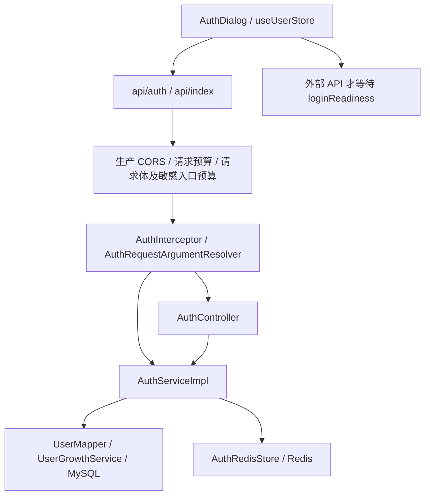
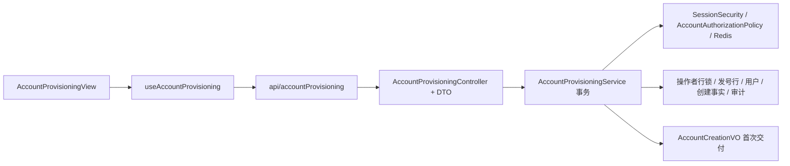
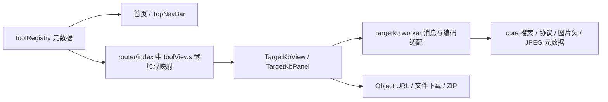

# 框架优化：基线与架构取舍

2026-11-14，F2 评估。源码基线 `f4a9826`，分支 `codex/framework-optimization`，开始时工作区干净。该提交的两端源码、依赖清单、锁文件和 Vite 配置与本机 `main` 相同；线上验收基线仍按阶段记录为 `aaa4ddc`。

本文件保存本阶段的评估依据和选择，不替代 [AGENTS.md](../../AGENTS.md)。实施范围见[阶段计划](../plans/framework-optimization.md)，实际交付见 [dev.14](../dev-log/v1.0-dev.14.md)。本轮没有修改业务、测试或配置。

## 1 · 当前决定

保留现有单体、后端 Controller → Service → Mapper 分层，以及前端页面/状态、Worker、纯算法边界。当前已有按职责划分的开户、安全、管理和审核服务，两个工具也能独立接入。没有发现必须通过全项目改包名或改目录才能解决的扩展障碍。

下一批优先做小范围冗余清理，再试点整理重复的测试加载代码、为核心隔离增加可执行检查。暂不引入新框架、测试运行器、多模块构建、通用工作流或权限平台；不合并安全事务，不减少独有行为断言。物理目录重组和工具任务状态抽取保留为需另行确认的 F5 候选。

这不是对未来规模的保证：当前静态走读及本机普通验收不足以证明任意新增业务、并发规模或依赖变化都安全。后续按具体需求扩展，并复核下面的边界。

## 2 · 可复用的验证基线

### 环境与口径

Windows 11 x64、JDK 21.0.12.1、Maven 3.9.4、Node 24.22.1、npm 11.19.1。现有安装解析到 Vue 3.5.44、Vite 8.3.5、TypeScript 6.0.3、Element Plus 2.14.7、Axios 1.20.0；后端声明 Spring Boot 3.3.5、Tomcat 10.1.61。版本均未修改。

在宿主机执行仓库原有 `polyhouse/scripts/Test-Project.ps1`，记录阶段起止与本次新生成的报告。使用已有依赖、Maven 缓存和编译产物，不含安装耗时，也不是冷机性能测试。本轮只建立一次完整基线；尚无多次中位数或优化前后收益结论，不能把下面的秒数当作稳定承诺。

| 原入口中的步骤 | 本次墙钟耗时 | 结果 |
| --- | ---: | --- |
| `mvn -q compile -DskipTests` | 4.02 s | 通过 |
| 后端普通 `mvn test`，9 类真实实例开关显式关闭 | 32.86 s | 通过，统计见下文 |
| `npm run lint:check` | 10.45 s | 通过，不自动修复 |
| `npm test` | 4.09 s | 341 项通过，失败/跳过均为 0；Node 报告测试耗时 3.13 s |
| `npm run build`，包含类型检查与生产构建 | 10.61 s | 通过 |
| 整个入口，包含包装器开销 | 62.14 s | 全部通过 |

后端本次生成 **47 份套件报告，发现 435 项，通过 331 项，跳过 104 项，失败及错误均为 0**。报告目录还残留 3 份未在本次更新的旧报告，共 14 项：`AvatarServiceTest`、`LocalAvatarStorageTest`、`PrivateProfileImagesTest`。这些类已不在当前测试源码中，本轮没有执行它们，统计已按报告更新时间排除；不直接累加整个 `target/surefire-reports` 目录。

较慢套件为 `GlobalExceptionHandlerTest` 7.24 s、`PolyhouseApplicationTests` 3.72 s、`AuthServiceImplTest` 2.94 s、`ProductionHttpTest` 2.38 s、`PasswordUtilsTest` 1.80 s。套件计时包含上下文、类加载或模拟准备，不能据此认定断言或密码哈希需要删减；本轮没有进一步做 CPU 分析。

### 实例开关与覆盖

下表为本次跳过数，不是本轮真实实例验收结果。分组依据测试源码的 `@EnabledIfSystemProperty` 及新报告。

| 开关 `polyhouse.*` | 本次跳过 | 主要保护内容与入口 |
| --- | ---: | --- |
| `mysql.integration` | 5 | Mapper 真实数据库读写；历史入口，已有正式屋主时不得盲跑全量 |
| `redis.integration` | 7 | 连接、TTL、多端会话及原子退出；同上 |
| `auth.integration` | 38 | HTTP/服务认证、事务、成长、唯一屋主；含 OWNER 夹具，不在开发库直接开启 |
| `jwt.runtime` | 1 | 实际运行密钥配置；不以单元测试替代私有环境核验 |
| `security.integration` | 7 | 改密、重置、凭据版本、失效与并发；`-AccountSecurityOnly` |
| `provisioning.integration` | 10 | 开户、发号、幂等、一次性凭据及角色；`-AccountProvisioningOnly` |
| `management.integration` | 15 | 管理范围、封禁/解封/重置、重试与并发；`-AccountManagementOnly` |
| `profile.integration` | 20 | 审核版本、图片隐私、配额、发布与并发，含额外浏览器条件；`-ProfileModerationOnly` |
| `capacity.integration` | 1 | 独立故障注入及恢复；`Test-CapacityRecovery.ps1` |

四个账号专项均在测试内创建随机数据库、限制本机连接，并以严格名称检查删除自己的库；Redis 使用精确用户键清理。它们各有嵌套 `Sandbox` 准备代码，不能为了共享上下文而共享用户、库或故障连接。浏览器交互方法还需相应显式环境开关；普通单测和 WebMvc 模拟均不证明真实浏览器交互通过。各命令和条件统一查[验证入口](../operations/verification.md)。F1 的实际浏览器证据单列在阶段日志，不冒充本轮重验。

原始耗时、新报告摘要和完整普通验收输出位于本机 Git 忽略的 `.local-backups/f2-baseline-20261114/`，以上表格是可随仓库交接的事实摘要。

## 3 · 三条实际调用链

### 认证与会话

- [登录窗](../../polyhouse-web/src/components/AuthDialog.vue)只在外部 API 等待匿名 `/auth/me` 就绪，随后通过 [useUserStore](../../polyhouse-web/src/stores/useUserStore.ts)提交一次登录；[api/auth](../../polyhouse-web/src/api/auth.ts)分配 PC/H5 槽位并校验响应。[api/index](../../polyhouse-web/src/api/index.ts)统一响应和会话失效回调。恢复身份必须读服务端 `/me`；版本号防止换号、退出和迟到响应覆盖新身份。
- [生产入口](../../polyhouse/src/main/java/com/polyethene/polyhouse/config/ProductionConfig.java)在 MVC 前执行实例预算等限制；本机默认 profile 不等同生产限额。登录方法显式跳过 Bearer，仍走 DTO 校验；受保护方法由[拦截器](../../polyhouse/src/main/java/com/polyethene/polyhouse/interceptor/AuthInterceptor.java)核验，`/me` 复用本请求已验证的资料。
- [AuthServiceImpl](../../polyhouse/src/main/java/com/polyethene/polyhouse/service/impl/AuthServiceImpl.java)负责密码、签名、会话和账号状态；登录持有用户行锁到会话发布，成长由独立服务在事务中结算。读身份会再次核对数据库最新状态和 Redis 会话。这些重复核对有并发撤权语义，不能当作冗余查询统一删掉。Redis 不参加 SQL 事务，仍要保留提交失败及旧会话场景的保护。
- 验证分工：`AuthServiceImplTest`、`AuthWebMvcTest`、JWT/Redis/上下文单测保护业务及 HTTP 契约；真实事务/并发和多端由上表实例测试保护，浏览器恢复还需页面验收。

### 屋主开户

- [页面状态](../../polyhouse-web/src/composables/useAccountProvisioning.ts)持有创建意图、未知结果和一次性凭据，换号或卸载丢弃旧响应；确认接口查询事实，不自动重发开户或重新交付密码。
- [Controller](../../polyhouse/src/main/java/com/polyethene/polyhouse/controller/AccountProvisioningController.java)只接 DTO、返回 VO 和 `no-store` 响应。[服务](../../polyhouse/src/main/java/com/polyethene/polyhouse/service/AccountProvisioningService.java)在事务内重新锁定并核验屋主，按“操作者 → 发号行”顺序推进。[Mapper](../../polyhouse/src/main/java/com/polyethene/polyhouse/mapper/AccountProvisioningMapper.java)分别处理发号、用户和幂等事实，审计同事务；密码只存哈希。
- 当前角色与动作规则集中在 [AccountAuthorizationPolicy](../../polyhouse/src/main/java/com/polyethene/polyhouse/common/security/AccountAuthorizationPolicy.java)，凭据版本及初始改密限制复用 [SessionSecurity](../../polyhouse/src/main/java/com/polyethene/polyhouse/common/security/SessionSecurity.java)。不把管理权限简化为角色权重，不通过通用实体更新安全列。
- 验证分工：前端 `account-provisioning.test.mjs` 保护重试、一次性凭据和换号；`AccountProvisioningWebMvcTest` 保护 HTTP；策略单测与隔离 `AccountProvisioningIntegrationTest` 保护真实事务和 SQL 约束。目录集中无法替代这些跨层契约。

### 本地工具，以妙压为主

- [注册表](../../polyhouse-web/src/config/toolRegistry.ts)维护展示元数据，[路由](../../polyhouse-web/src/router/index.ts)维护真正的懒加载页面映射并在缺失时报错。两者职责不同，不是重复的工具清单；目前无需合成一个引入页面组件的公共配置。
- [TargetKbPanel](../../polyhouse-web/src/components/TargetKbPanel.vue)编排选图、批量队列、任务 id、Worker 和 URL 生命周期；[Worker](../../polyhouse-web/src/workers/targetkb.worker.ts)适配实际图像解码/编码，`core/` 处理纯算法与协议。任务 id、取消、迟到 ZIP 回调和资源释放是关键边界。妙替同样由页面 → Worker → `core` 完成本机处理，词库/草稿另用已有本地存储入口，不调用后端占位类。
- 本轮对 `core/`、`workers/` 的直接 import 及禁止的 `window/document/navigator` 访问做定向静态扫描，未发现 UI/响应式依赖或这些全局访问。该扫描不等同完整依赖分析；现有 ESLint 配置还没有专门强制这条隔离约束。
- 算法测试保护字节、容量、计数与匹配结果；生命周期测试用可控 Worker/ZIP 回调保护取消及释放；实际浏览器文件选择、图片编码、下载和布局另验，三种覆盖不能相互替代。

## 4 · 两个扩展示例与目录取舍

| 走读场景 | 当前需要理解/修改什么 | 改成业务目录能解决什么、解决不了什么 |
| --- | --- | --- |
| 增加一个同类本地工具，沿用现有图标与分类 | 注册表加元数据，`router/index.ts` 加懒加载映射，新增自己的页面/组件；按需要增加纯算法、Worker 和对应测试。首页和导航已有动态读取，账号与后端无需随之修改 | 业务目录可把未来增多的专属文件放近，但不能省掉元数据、页面、算法和测试这些不同职责。当前两工具接入没有公共层改造需求 |
| 在账号域扩展一条开户角色规则 | 策略、DTO/接口校验、前端选项和响应解码、数据库约束及对应测试。实际提交 `8a8f625` 的 INSIDER 开户涉及 9 个文件，其中含 2 个后端测试和迁移 | 把文件移动到 `account/` 不会消除这些必要契约；将来账号域和独立业务域都增长后，按域收拢可减少查找跨度，但当前不能据跨层文件多就改公共认证 |

后端 111 个生产 Java 文件约 5,356 行，主要服务已经按开户、安全、管理、审核、成长分职责。定向 import 检查未发现 Service/Mapper 反向依赖 Controller，或 utils 依赖 Service/Mapper；没有据此宣称整个项目不存在任何依赖环。为按域迁移需联动根包下的扫描、`model.dto.*`/`model.vo.*` 约定、MyBatis、测试同包可见性，以及 `OwnerBootstrapCommand` 的独立扫描，成本远高于目前已证实的收益。

前端最大文件需区分代码职责：`TargetKbPanel.vue` 1,044 行，其中 script 587、template 156、style 233；`AccountView.vue` 819 行，其中 script 107、template 239、style 440。行数不直接说明业务过重。妙压确有较多任务编排，但应只在同一需求能证明改动/测试更容易时试点抽取，不顺带重排相邻布局、共享样式或两工具的任务协议。

## 5 · 候选与下一步

下表是实施选择，不表示候选已经完成。每批开始前仍核对引用和工作区，按影响验证，独立提交和回退。

| 候选 | 证据与预期收益 | 分类及边界 | 验证与回退 |
| --- | --- | --- | --- |
| 删除妙替/妙压后端各一组空 Controller、Service、Impl，共 6 个类型 | 类体无方法，Controller/Impl 无注册注解；源码搜索只见自身定义及空实现引用接口。原策划书保留的是未来云能力，当前端侧功能不需要这些类型 | F3 优先；删除前补查反射、扫描、脚本及资源配置。只清空壳，不删除预设表、实体、Mapper 或关闭注册的兼容响应 | 后端编译、应用扫描及相关普通测试；用本批提交恢复 |
| 移除无调用的 `ToolComingSoon.vue` | 两工具已实现，路由均加载真实页面；生产 import 未命中，仅旧计划/日志描述历史占位页 | F3 可选，同批前再次核对动态引用；保持注册表状态与历史文档事实 | 前端 lint/build、路由入口核对；用本批提交恢复 |
| 合并测试中的 TS 加载基础代码 | 29 个前端测试模块均调用 `transpileModule`，存在重复的编码、编译参数和 import 替换。全套测试已较快，现有数据不足以证明转换是主要瓶颈 | F4 在妙替的少数纯模块测试试点，只减少维护重复；不用全局缓存、不共享可变模拟、不换运行器、不删独有断言，不承诺提速 | 同口径发现/通过/跳过数与耗时；必要时在隔离副本注入代表性错误，确认旧失败仍能检出；收益不足则回退 |
| 将纯算法边界接入现有静态检查 | 当前规则有文字约束，ESLint 尚无专门限制；未来直接引入 Vue/UI 或浏览器主线程全局可能静默越界 | 可直接设计一个小闭环；使用现有能力限定 `core/workers` 的禁止依赖，保留 Worker 已批准的编码适配能力，不扩大禁令 | 当前源码 lint/build；临时合法/违规样例验证能允许现有模式、拒绝真正越界，完成后清理样例；独立回退 |
| 抽取四专项的数据库 Sandbox | 四个专项各有建库/导入/删除准备；安全检查、清理和浏览器保留行为并不完全相同 | 延后。普通验收跳过它们，不能称为本次主要耗时；若做，先限一个专项并真实验收异常清理，不合并随机库、会话和故障状态 | 必须补真实隔离专项，不能只跑单测；逐专项回退 |
| 妙压任务编排抽为模块内 composable | 单图/批量、Worker、取消、URL/ZIP 编排集中，生命周期测试依赖 SFC 编译和源代码替换 | F5 需试点方案确认；当前不实施。先比较同一小改动在两种路径下的成本，保留公开接口与协议 | 若获批，生命周期/算法测试、两端所涉构建及真实浏览器取消/下载验收；模块内独立回退 |
| 全后端按域重组、统一认证锁定帮助类、合并 Spring 测试上下文 | 当前无必须搬迁的需求；认证、成长与管理的锁序/撤权语义不同；慢套件包含上下文准备，尚未精确分析 | 延后。保留当前稳定调用链；不以类名相似或测试数量多作为合并依据 | 有具体需求和收益证据后另定范围 |
| CI/版本声明整顿 | 本仓库 Pages 工作流为 main 推送触发，使用 Node 20 和 `npm install`，与本地声明存在差异；没有普通前后端测试门禁 | 已记录，继续冻结版本。本轮未核验远端分支保护、根站仓库工作流或 Render 当前设置；不声称已有受保护门禁 | 工作流/版本调整和远端写入另行授权 |

F3 首批只清理已证实的占位类型；F4 首批优先测试加载代码的小试点。核心隔离检查可以作为单独闭环插入。F5 不进行全项目目录搬迁，单模块试点只有明确收益并确认范围后才开展。

## 6 · 参考如何应用

- [Spring Boot 3.3 代码结构说明](https://docs.spring.io/spring-boot/3.3/reference/using/structuring-your-code.html)没有强制唯一布局，并建议启动类位于根包。本项目据此保留根包与当前布局；官方按业务分包示例是一种选择，不等于必须迁移。
- [Vue 测试指南](https://vuejs.org/guide/scaling-up/testing.html)区分纯逻辑、组件与端到端测试，并强调公开行为。这里借用覆盖分工及避免绑定实现细节的原则；本阶段沿用 Node test，不安装其推荐的新运行器。
- [Spring Modulith 边界验证思路](https://docs.spring.io/spring-modulith/reference/verification.html)关注模块无环、通过公开入口访问及显式依赖。本项目只借鉴判断标准，没有引入依赖，也没有宣称已运行其模块验证器。
